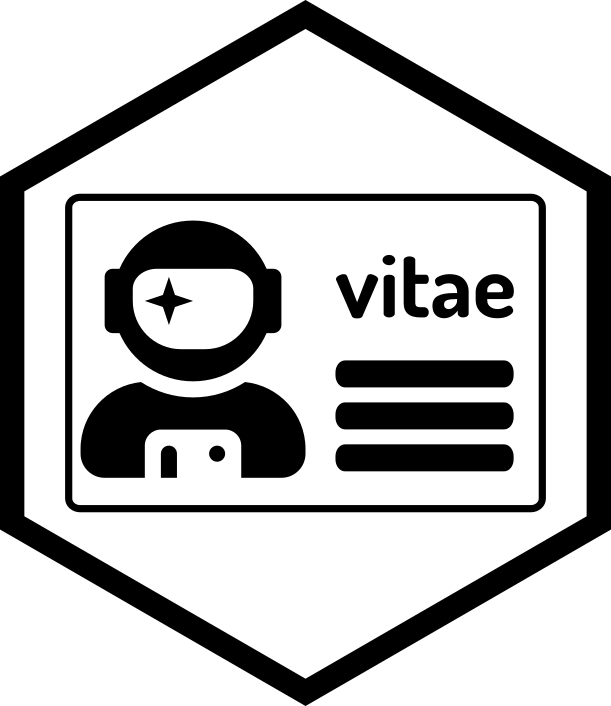

# Quarto Vitae

Quarto extensions for writing CVs and résumés.

Populate your CV with entries drawn from a spreadsheet, script, or database.

[Browse templates](templates.llms.md)

[Writing a CV](using-templates.llms.md)

[Already using vitae with R Markdown? Migrate to Quarto vitae →](migration.llms.md)

Fundamentals

## Data-driven CVs

CV entries are rows from a data source: a data frame, a CSV file, or a bibliography.

Store all your expertise and experiences in data, then filter down to what’s relevant for each job.

**From your data**

## ![]() R

```` markdown
```{r}
#| echo: false
#| vitae: {style: detailed}
data.frame(
  what = "Ph.D. in Physics",
  with = "University of Paris",
  when = "1891-1895",
  why  = "Discovered polonium and radium"
)
```
````

## ![]() Python

```` markdown
```{python}
#| echo: false
#| vitae: {style: detailed}
import pandas as pd
pd.DataFrame({
    "what": ["Ph.D. in Physics"],
    "with": ["University of Paris"],
    "when": ["1891-1895"],
    "why":  ["Discovered polonium and radium"],
})
```
````

##  Julia

```` markdown
```{julia}
#| echo: false
#| vitae: {style: detailed}
using DataFrames
DataFrame(
  what = "Ph.D. in Physics",
  with = "University of Paris",
  when = "1891-1895",
  why  = "Discovered polonium and radium"
)
```
````

→

Rendered

Ph.D. in Physics 1891-1895

University of Paris

- Discovered polonium and radium

A bibliography works the same way, filtered directly from a `.bib` file:

**From a bibliography**

``` markdown
::: {.entries style="bibliography" file="pubs.bib"}
:::
```

→

Rendered

Curie, M., & Curie, P. (1898). On a new, strongly radioactive substance contained in pitchblende. *Comptes Rendus*, 127, 175-178.

Contact details and profiles are front matter, written as `service: handle`. Every template reads them the same way, so switching designs never touches them.

**Share your socials**

``` yaml
social:
  - email: marie.curie@example.org
  - github: mcurie
  - mastodon: "@mcurie@fosstodon.org"
  - orcid: 0000-0001-2345-6789
```

→

Rendered

✉ marie.curie@example.org  ·  github.com/mcurie  ·  @mcurie@fosstodon.org  ·  0000-0001-2345-6789

[Learn how to write a CV with vitae →](using-templates.llms.md)

Templates

## Pick a design and start writing

[](https://github.com/quarto-vitae/awesomecv)

#### [Awesome CV](https://github.com/quarto-vitae/awesomecv)

A Quarto vitae template for Awesome-CV

[](https://github.com/quarto-vitae/hyndman)

#### [Hyndman CV](https://github.com/quarto-vitae/hyndman)

A Quarto vitae template created and used by Rob Hyndman

[](https://github.com/quarto-vitae/latexcv)

#### [latexcv](https://github.com/quarto-vitae/latexcv)

A Quarto vitae template for latexcv

[Browse all templates →](templates.llms.md)

[Create your own template →](creating-templates.llms.md)
